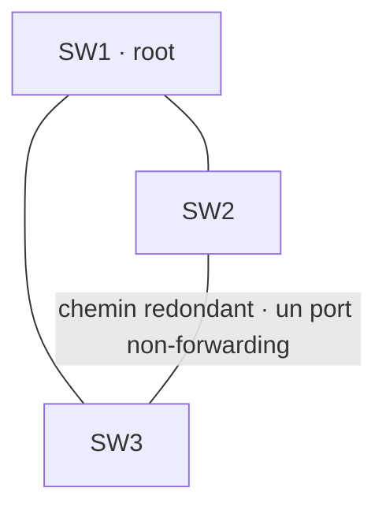

# 05 · STP et choix du chemin sans boucle

[Fiche précédente](../02-switching/04-vlan-trunk-qinq.md) · [Sommaire](../../README.md) · [Fiche suivante](../02-switching/06-rstp-mstp.md)

## Comprendre

Une boucle Ethernet peut multiplier les broadcasts et provoquer des changements rapides d'apprentissage MAC. STP construit une topologie logique sans boucle en désactivant certains chemins de données tout en conservant les liens physiques.

Le root bridge est élu selon le Bridge ID le plus faible. Il combine une priorité et un identifiant de pont, avec des particularités de système étendu selon l'instance. Chaque switch non-root choisit son root port, puis un designated port est choisi par segment. Le coût du chemin et les identifiants départagent les candidats.

| État STP classique | Données utilisateur |
| --- | --- |
| Blocking | Non transférées |
| Listening | Non transférées |
| Learning | Apprentissage MAC, sans transfert utilisateur |
| Forwarding | Apprentissage et transfert |

Les BPDUs portent les informations utilisées par l'élection. Les temporisations participent à la transition classique. Une conception place le root là où le chemin de trafic doit être privilégié au lieu de laisser le choix dépendre des seules adresses matérielles.

PortFast/edge accélère l'entrée en service d'un lien vers un terminal. BPDU Guard traite la réception de BPDUs sur les ports où elles sont interdites. Root Guard protège une frontière contre une nouvelle racine inattendue. Ces protections répondent à des risques différents.

## Visualiser

## Exemple concret

Trois switches forment un triangle. Un chemin devient non-forwarding pour casser la boucle. Débrancher un lien actif peut rendre le chemin de secours utile. Le blocage initial est donc un fonctionnement attendu.

## Pièges à éviter

- Supprimer un blocage STP sans comprendre la boucle qu’il évite.
- Activer un comportement edge sur un lien inter-switch non maîtrisé.
- Confondre Root Guard et BPDU Guard.

## Ce qu’il faut observer

Relever root, coût, rôles et états par instance. Corréler changements de topologie, MAC flapping et événements de port.

## Révision active

Réponds à voix haute avant d’ouvrir chaque correction.

### Question 1

Quel Bridge ID gagne l’élection ?

Afficher la correction

Le plus faible, selon les champs comparés par le protocole.

### Question 2

Un port bloqué signifie-t-il nécessairement un incident ?

Afficher la correction

Non. Il peut représenter le chemin redondant nécessaire à la prévention d’une boucle.

### Question 3

Que protège BPDU Guard ?

Afficher la correction

Une frontière où la réception de BPDUs est considérée comme anormale, typiquement un port de terminal.

## Sources pour approfondir

- [Documentation de référence 1](https://www.ieee802.org/1/pages/802.1Q.html)

Les mécanismes décrits servent à réviser. Les détails CLI et les limites de produit doivent être vérifiés dans la documentation de la version utilisée.
