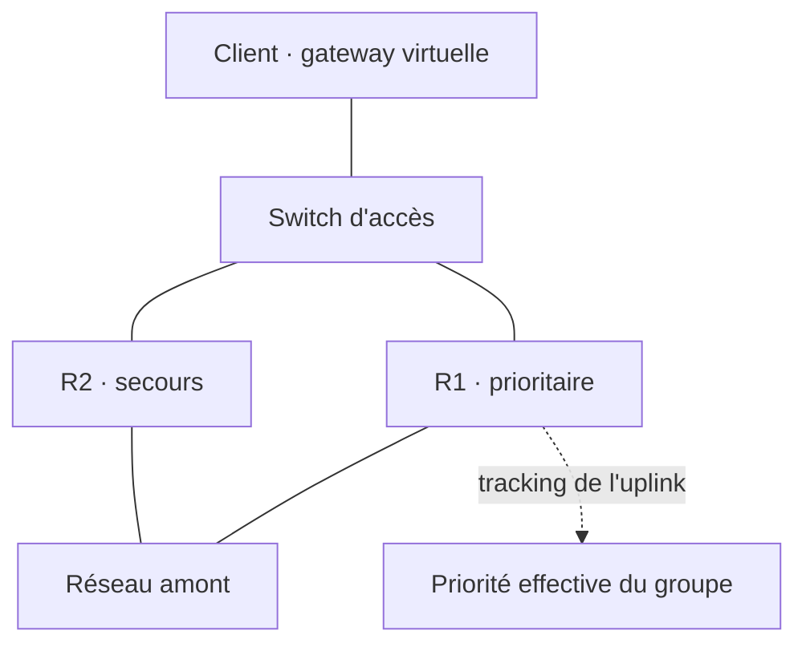

# 40 · HSRP, VRRP, BFD et convergence

[Fiche précédente](../03-ip-et-routage/39-multicast.md) · [Sommaire](../../README.md)

## Comprendre

Une architecture résiliente conserve le service sous des pannes explicitement prévues. Redondance d'équipements, diversité de chemin et contrôle de convergence sont des dimensions différentes.

HSRP et VRRP fournissent des fonctions de passerelle redondante. Un groupe utilise une adresse virtuelle et des mécanismes d'élection pour décider du rôle actif ou principal. Les priorités, préemption et tracking influencent les transitions.

| Fonction | Ce qu'elle traite |
| --- | --- |
| FHRP | Continuité de la passerelle des hôtes |
| Tracking | Changement de priorité selon un état surveillé |
| BFD | Détection rapide de perte de chemin selon session |
| IGP/BGP | Choix et propagation des routes après événement |

BFD fournit une détection, mais ne remplace pas la logique qui choisit la nouvelle route. Les timers et capacités de traitement doivent être cohérents. Détecter plus vite n'améliore pas toujours l'expérience si cela provoque des bascules inutiles.

Une passerelle peut rester active tout en ayant perdu son uplink. Le tracking doit alors prendre en compte un signal pertinent. Suivre seulement l'état physique n'observe pas une panne distante qui laisse le port up.

La recette mesure perte, délai de reprise, état des sessions, ARP/ND et état NAT si pertinent. Elle doit tester les risques partagés, dont alimentation, châssis, opérateur et point central commun.

## Visualiser

## Exemple concret

R1 a priorité 110, R2 100. Un decrement de 5 laisse R1 à 105 et ne réalise pas l'objectif de bascule. Un decrement de 30 le place à 80, mais la préemption et les mécanismes du groupe doivent aussi être cohérents.

## Pièges à éviter

- Confondre BFD et protocole de routage.
- Additionner des composants redondants partageant la même panne.
- Tester seulement la coupure physique au lieu des scénarios définis.

## Ce qu’il faut observer

Observer rôles, priorité effective, objet tracké, BFD et chronologie des routes. Vérifier le service avant, pendant et après la reprise.

## Révision active

Réponds à voix haute avant d’ouvrir chaque correction.

### Question 1

Pourquoi suivre un uplink ?

Afficher la correction

Pour éviter qu’une passerelle reste préférée quand sa capacité de transfert utile est perdue.

### Question 2

BFD fournit-il une route de secours ?

Afficher la correction

Non. Il détecte un état de session et les mécanismes associés réagissent selon leur configuration.

### Question 3

Quel est l’intérêt de mesurer le trafic pendant la panne ?

Afficher la correction

Cela démontre la convergence réelle et les pertes visibles, au-delà des états de protocole finaux.

## Sources pour approfondir

- [RFC 5880](https://www.rfc-editor.org/rfc/rfc5880)
- [RFC 9568](https://www.rfc-editor.org/rfc/rfc9568)
- [Documentation de référence 3](https://www.cisco.com/c/en/us/support/docs/ip/hot-standby-router-protocol-hsrp/13780-6.html)

Les mécanismes décrits servent à réviser. Les détails CLI et les limites de produit doivent être vérifiés dans la documentation de la version utilisée.
