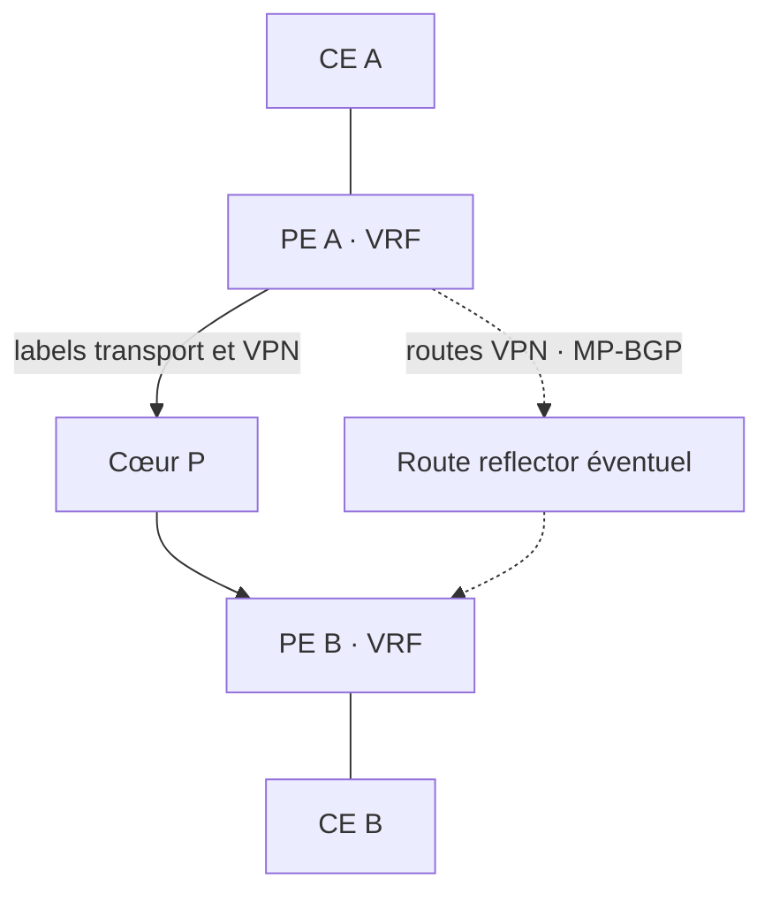

# 22 · MPLS L3VPN, RD, RT et MP-BGP

[Fiche précédente](../04-mpls-et-overlays/21-mpls.md) · [Sommaire](../../README.md) · [Fiche suivante](../04-mpls-et-overlays/23-l2vpn.md)

## Comprendre

Une L3VPN BGP/MPLS sépare les routes des clients sur les PE et échange leur joignabilité à travers MP-BGP. Les CE se connectent aux PE. Les routeurs P fournissent le transport sans devoir connaître les routes de tous les clients.

| Élément | Fonction |
| --- | --- |
| CE | Routeur côté client |
| PE | Termine les accès et les contextes VPN |
| P | Transporte les paquets dans le cœur |
| RD | Rend distincts des préfixes potentiellement identiques |
| RT | Extended community contrôlant l'import/export |

Le RD contribue à l'identité de la route VPN. Il ne décide pas à lui seul quelles VRFs l'importent. Les RT portent cette politique. Une route exportée avec un RT ne devient utilisable que si la politique d'import et les dépendances de forwarding sont satisfaites.

Le PE apprend les routes du CE via statique ou protocole. Il les exporte dans la famille VPN appropriée avec les attributs et informations de service nécessaires. Le PE distant les importe dans sa VRF.

Dans le cas MPLS courant, le trafic client reçoit un label VPN et un label de transport vers le PE de sortie. Les contextes de forwarding et la résolution du next-hop doivent fonctionner des deux côtés. Le service ne chiffre pas automatiquement le trafic.

## Visualiser

## Exemple concret

Deux clients annoncent 10.0.0.0/24. Des RD différents permettent de distinguer les routes VPN. Un RT commun, s'il est importé, peut volontairement créer une connectivité. Le choix des RT demande donc une vraie politique.

## Pièges à éviter

- Utiliser RD et RT comme synonymes.
- Supposer qu’un RT importé prouve l’atteinte du next-hop.
- Attendre des routes client sur tous les routeurs P.

## Ce qu’il faut observer

Vérifier CE-PE, route dans la VRF, export VPN, RD/RT, import distant, labels de service et transport, puis chemin retour.

## Révision active

Réponds à voix haute avant d’ouvrir chaque correction.

### Question 1

Qui décide l’appartenance d’une route à une politique d’import ?

Afficher la correction

Les RT et la politique d’import configurée, pas le RD seul.

### Question 2

Le cœur P doit-il connaître tous les préfixes client ?

Afficher la correction

Pas dans le modèle L3VPN décrit, où il assure le transport entre PE.

### Question 3

Pourquoi une route VPN visible peut-elle rester inutilisable ?

Afficher la correction

Le transport vers le PE distant, le label de service, l’import ou le retour peuvent être incomplets.

## Sources pour approfondir

- [RFC 4364](https://www.rfc-editor.org/rfc/rfc4364)

Les mécanismes décrits servent à réviser. Les détails CLI et les limites de produit doivent être vérifiés dans la documentation de la version utilisée.
