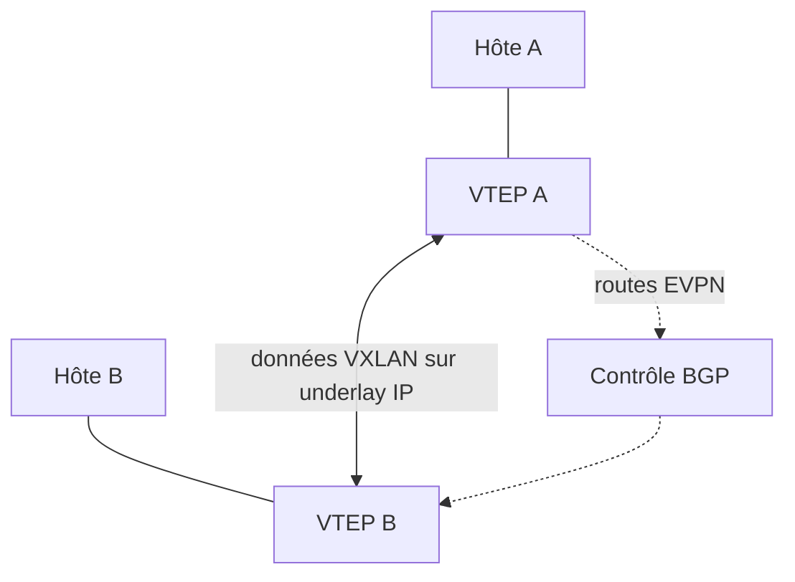

# 25 · EVPN, routes BGP et IRB

[Fiche précédente](../04-mpls-et-overlays/24-vxlan.md) · [Sommaire](../../README.md) · [Fiche suivante](../05-transport-et-services/26-tcp.md)

## Comprendre

EVPN utilise BGP pour distribuer des informations de services Ethernet. Il peut s'appliquer à un transport MPLS ou à un overlay comme VXLAN. La famille de contrôle reste distincte du mécanisme de transport des données.

| Type de route | Usage courant |
| --- | --- |
| 1 | Ethernet Auto-Discovery, notamment multihoming |
| 2 | Annonce MAC et éventuellement IP |
| 3 | Inclusive Multicast Ethernet Tag, utile au BUM |
| 4 | Ethernet Segment, procédures de multihoming |
| 5 | Annonce de préfixe IP selon les extensions |

Les RD distinguent les routes et les RT participent aux politiques d'import/export. L'ESI identifie un segment Ethernet en multihoming. Les procédures de designated forwarder et de split horizon participent à la maîtrise des duplications et boucles.

L'IRB relie la commutation intra-segment et le routage entre segments. Les designs symétriques et asymétriques ne placent pas les mêmes exigences de VRF/VNI sur les VTEP. Une passerelle anycast peut fournir un service de gateway distribué.

La distribution d'une association MAC/IP peut permettre une suppression ARP/ND, selon les capacités et politiques. Une annonce de contrôle doit rester cohérente avec l'hôte réel, la mobilité et le forwarding local.

## Visualiser

## Exemple concret

Une MAC cliente est annoncée en route type 2 par le VTEP d'entrée. Le VTEP distant doit l'importer dans le bon service et disposer du transport vers son origine. Une route présente dans BGP ne prouve pas à elle seule que la table MAC et le tunnel soient corrects.

## Pièges à éviter

- Mélanger type 2 MAC/IP et type 5 préfixe.
- Confondre ESI, VNI, RD et RT.
- Supposer qu’une passerelle anycast corrige un mauvais mapping de VRF.

## Ce qu’il faut observer

Lire route EVPN, RT, next-hop, MAC/IP, VNI et ESI si présent. Comparer avec la table locale et les mécanismes de transport.

## Révision active

Réponds à voix haute avant d’ouvrir chaque correction.

### Question 1

EVPN exige-t-il VXLAN ?

Afficher la correction

Non. Il existe notamment des usages EVPN avec transport MPLS.

### Question 2

Quel type porte généralement une MAC/IP ?

Afficher la correction

Le type 2.

### Question 3

Quel type transporte un préfixe IP dans les extensions correspondantes ?

Afficher la correction

Le type 5.

## Sources pour approfondir

- [RFC 7432](https://www.rfc-editor.org/rfc/rfc7432)
- [RFC 8365](https://www.rfc-editor.org/rfc/rfc8365)
- [RFC 9136](https://www.rfc-editor.org/rfc/rfc9136)
- [RFC 9135](https://www.rfc-editor.org/rfc/rfc9135)

Les mécanismes décrits servent à réviser. Les détails CLI et les limites de produit doivent être vérifiés dans la documentation de la version utilisée.
