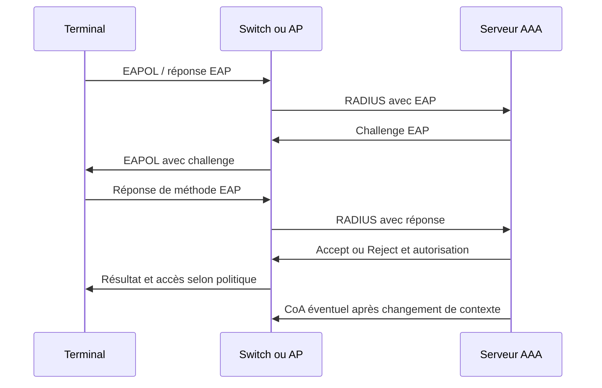

# 34 · NAC, 802.1X, EAP, RADIUS et CoA

[Fiche précédente](../06-securite-et-sdwan/33-sdwan.md) · [Sommaire](../../README.md) · [Fiche suivante](../07-acces-et-wifi/35-wifi-radio.md)

## Comprendre

Le NAC associe identité, contexte et politique d'accès. Il peut combiner authentification, profilage, posture et autorisation, avec des fonctionnalités dépendant du produit.

| Acteur 802.1X | Fonction |
| --- | --- |
| Supplicant | Terminal demandant l'accès |
| Authenticator | Switch ou AP contrôlant l'accès |
| Authentication server | Service qui évalue l'authentification et la politique |

EAP fournit un cadre de méthodes d'authentification. EAPOL transporte les échanges EAP sur la liaison entre terminal et authenticator. RADIUS est couramment utilisé entre authenticator et serveur. Les ports traditionnels UDP 1812/1813 servent à authentification et accounting, avec d'autres transports sécurisés possibles selon le déploiement.

EAP-TLS utilise des certificats pour l'authentification mutuelle. La confiance dans le serveur, la validation des chaînes, les identités et le temps sont essentiels. MAB utilise une identité de type adresse MAC et fournit un niveau de preuve très différent d'un certificat.

L'autorisation peut attribuer VLAN, ACL ou rôle. CoA permet de demander une modification de session dans les déploiements compatibles, traditionnellement sur UDP 3799. Une authentification réussie ne prouve pas que le rôle final accorde le bon accès.

La politique de serveur indisponible doit être explicite. Une ouverture de secours et une fermeture stricte ont des impacts différents sur la disponibilité et l'exposition.

## Visualiser

## Exemple concret

Un poste reçoit Access-Accept mais reste isolé. La collecte doit lire l'autorisation effective, le VLAN ou rôle appliqué, l'adresse acquise et le chemin réseau, en plus du résultat EAP.

## Pièges à éviter

- Confondre authentification et autorisation.
- Assimiler une MAC reconnue à une preuve forte d’identité.
- Négliger l’heure et la confiance du certificat serveur.

## Ce qu’il faut observer

Suivre session d’accès, méthode EAP, réponse RADIUS, rôle appliqué, logs client et serveur. Vérifier le comportement en panne du service.

## Révision active

Réponds à voix haute avant d’ouvrir chaque correction.

### Question 1

Qui est l’authenticator sur un port filaire ?

Afficher la correction

Le switch qui contrôle l’accès au lien.

### Question 2

À quoi sert CoA ?

Afficher la correction

À demander une modification d’autorisation ou de session selon le mécanisme et le produit.

### Question 3

Un Access-Accept prouve-t-il le service accessible ?

Afficher la correction

Non. L’autorisation appliquée et le chemin après authentification doivent être validés.

## Sources pour approfondir

- [Documentation de référence 1](https://1.ieee802.org/security/802-1x/)
- [RFC 3748](https://www.rfc-editor.org/rfc/rfc3748)
- [RFC 3580](https://www.rfc-editor.org/rfc/rfc3580)
- [RFC 2865](https://www.rfc-editor.org/rfc/rfc2865)
- [RFC 5176](https://www.rfc-editor.org/rfc/rfc5176)
- [RFC 9190](https://www.rfc-editor.org/rfc/rfc9190)

Les mécanismes décrits servent à réviser. Les détails CLI et les limites de produit doivent être vérifiés dans la documentation de la version utilisée.
